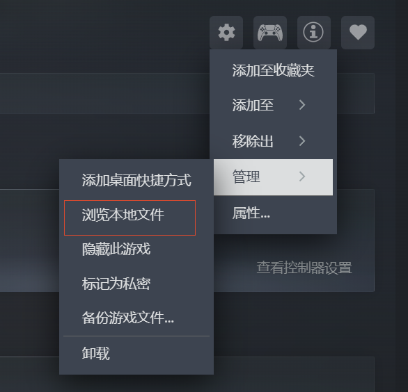
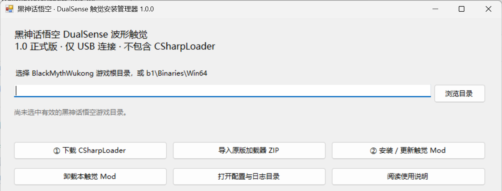

# 黑神话：悟空 DualSense 波形触觉 Mod

**当前版本：1.0 正式版（1.0.0）。**

想体验更有力度的“三千阳春”，再感受一下马哥挥鞭时的触觉反馈吗？

本 Mod 为 PC 版《黑神话：悟空》增加 DualSense 手柄的 **USB 波形触觉**。不同棍法、棍势和招式有不同的反馈；重点适配的几种变身，也加强了攻击的重量感，让轻击、重击、大招，以及蓄力、腾空、突进这些过程更有区别。

## 下载

下载地址：[GitHub Releases（发行版）](https://github.com/CCMCHE/Wukong-DualSense-Haptics/releases)。请选择 `WukongWaveHaptics-1.0.0-win-x64.zip`。

## 震动适配

- **棍法与命中**：轻棍连击、力度更重的第五式、不同棍势的重击、跳跃重击、已识别的切手技，以及部分攻击过程。重击会随棍势档位逐级增强。
- **蓄力与运动**：蓄力持续震动、获得棍势的提示，以及部分腾空、转动和突进过程。
- **变身与精魄**：重点适配赤潮、乌川、玄渊、金岚、黯雷、青穹的已采集招式。变身攻击加强重量感，并区分轻击、强化攻击、重击和大招，补充相应的蓄力、腾空及施法过程；另有精魄释放反馈，幽魂命中采用四段棍势重击级别的反馈。
- **法术与法宝**：不同法术的施放反馈、定身确认、铜头铁臂防御，以及辟火罩、定风珠、绣花针、芭蕉扇四件法宝已识别的施法反馈。
- **其他反馈**：走跑脚步、翻滚、精准闪避、受击、菜单切换、变身进入与还原、喝酒及物品使用。

## 使用条件

- Windows 10/11 64 位、PC 版《黑神话：悟空》和 .NET Framework 4.8。
- 原装 PS5 DualSense 手柄，使用支持数据传输的 **USB 线**连接。
- 关闭该游戏的 **Steam Input（Steam 输入）**，不运行 DSX 等同时控制手柄输出的程序。
- 游戏原生“手柄震动”设为 **0**；Windows 声音输出保持为平时的耳机或音箱。
- 需要 [CSharpLoader with hook 0.1.0](https://www.nexusmods.com/blackmythwukong/mods/664)。安装器可打开作者下载页面，手动下载原版 ZIP 后再导入；本包不内置加载器，也不需要 UE4SS。

## 安装与更新

先正常退出游戏，下载并完整解压 `WukongWaveHaptics-1.0.0-win-x64.zip`。外层只有“使用说明.txt”“安装管理器.exe”和“配套文件”文件夹。**配套文件保持原样，与安装器放在一起即可。**


### 第一步：选择游戏目录

打开“安装管理器.exe”，点击“浏览目录”，选择 `BlackMythWukong` 游戏根目录。也可以选择其中的 `b1\Binaries\Win64`。

不知道游戏装在哪里：在 Steam 库打开游戏页面，点击齿轮 → 管理 → 浏览本地文件。



### 第二步：安装加载器

未装加载器时，点击“① 下载 CSharpLoader”，在作者页面手动下载 **CSharpLoader with hook 0.1.0** 原版 ZIP。

回到安装器，点击“导入原版加载器 ZIP”，选中下载的 ZIP，无需自行解压。已有兼容加载器的玩家可以跳过这一步。

### 第三步：安装或更新触觉 Mod

点击“② 安装 / 更新触觉 Mod”，看到安装完成提示后即可关闭安装器。



安装器会自动确认 `EnableJit=1`，不用手动修改加载器配置。之后启动游戏，将游戏原生“手柄震动”调为 **0**，先走几步、轻击命中敌人测试。以后正常启动游戏即可，安装器不必常驻。

**旧版用户也点同一个“安装 / 更新触觉 Mod”按钮。** 它会清空本 Mod 的旧程序、配置和日志，再安装新版默认设置，成功后不留旧版备份。清理范围仅限 `WukongWaveHaptics` 文件夹，加载器和其他 Mod 不会被清理。

## 调节与卸载

想自行调节力度，可以通过安装器打开配置目录，编辑 WukongWaveHaptics.ini 的 Gain。默认 0.85，范围 0.1～1.0，保存后约 2 秒生效。再次安装或更新会恢复新版默认设置。

卸载前先退出游戏，点击“卸载本触觉 Mod”。它会删除整个 WukongWaveHaptics 文件夹，包括配置和日志；保留 CSharpLoader 与其他 Mod，不把共享的 EnableJit 改回 0。

## 已知情况

- 当前支持 USB 波形触觉，不支持蓝牙连接和自适应扳机；DualSense Edge 尚未经实物测试。
- 传送或死亡回土地庙后，触觉可能需要数秒恢复，个别情况下约 7～8 秒。
- 效果按已识别事件提供，尚未逐项覆盖所有招式和特殊形态。四件法宝已加入施法反馈，不代表龙卷风等全部持续效果均已覆盖。
- 当前效果已由我在自己的游戏环境中实测，不同游戏版本和电脑环境仍欢迎反馈。这是玩家制作的 Mod，并非官方适配。

## 问题反馈

如果只是本 Mod 没有生效或安装失败，先退出游戏，查看安装器提示，再尝试“安装 / 更新触觉 Mod”。**不要直接删除整个 `CSharpLoader` 来处理本 Mod 的问题，里面可能还有其他 Mod。** 若确实需要重装加载器，先确认并保存其他 Mod，再重新导入作者原版 ZIP。

反馈时请说明具体动作、实际现象、游戏版本、Windows 版本、手柄型号和连接方式。日志和配置在：

```text
游戏目录\b1\Binaries\Win64\CSharpLoader\Mods\WukongWaveHaptics\
```

可以把整个 `WukongWaveHaptics` 文件夹压缩后交给我排查。**重装或更新会清理旧日志，请先压缩保存再操作。** 公开上传前检查日志中的个人路径等信息；程序不会自动上传文件。

问题反馈：[GitHub Issues](https://github.com/CCMCHE/Wukong-DualSense-Haptics/issues)。

更详细的操作说明见安装包中的“使用说明.txt”和“配套文件/详细说明.txt”。